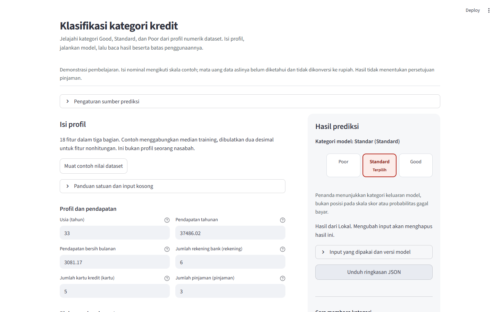

# Credit Score

[Live application](https://credit-score-steven.streamlit.app/) · [Source](https://github.com/SevenZ27/UAS) · [Portfolio case study](docs/PORTFOLIO.md)

An educational Streamlit application classifying the dataset categories **Good, Standard and Poor**. The project continues Model Deployment coursework with a shared training/inference pipeline, customer-disjoint evaluation and an accessible prediction interface. It does not estimate loan approval or probability of default.

The selected 300-tree forest achieved **68.61% accuracy and 0.6709 macro-F1** on 5,011 observations from 2,251 held-out customers. A prior baseline achieved 52.78% and 0.2303. The 95% customer-cluster bootstrap accuracy interval is 67.05–70.28% (2,000 replicates). These are same-dataset category results, not validation on future customers in a real lending service.



## Application behavior

- Eighteen named features, grouped inputs, optional unknown values, clear errors and downloadable profile/response JSON.
- Values outside the training reference ranges still receive a prediction **with a visible warning**. The response discloses actual clipping by the original fitted pipeline. Invalid numbers, impossible schema values and fractional counts remain errors. See [serving policy](docs/SERVING-POLICY.md).
- Monetary field labels use plain language. The source currency is unknown; displayed examples are not converted to rupiah.
- Editing inputs, resetting or switching backend clears stale results. Keyboard focus moves to a new result/error without stealing focus during edits.
- Benchmark, confusion counts, limitations and historical reference-domain coverage are available beside the form. No individual confidence gauge is invented.

## Run locally

Use Python 3.12. The active model is included, so running the app does not require the private CSV.

```powershell
uv sync --locked
uv run streamlit run app_streamlit.py --server.address 127.0.0.1 --server.port 8518
```

Open `http://127.0.0.1:8518/`. Without uv, create a Python 3.12 environment and install `requirements.txt`. It is exported from `uv.lock` without development dependencies. Streamlit Community Cloud uses repository `SevenZ27/UAS`, branch `main`, entrypoint `app_streamlit.py`, Python **3.12**, no secrets, and the checked-in `artifacts/pipeline.joblib`. The public deployment uses local CPU inference; an AWS account is not required.

Model version: `stage2-49c6876730d2`. The artifact is about 40 MB. Raw CSV, identifiers, private split indices and per-observation predictions are excluded from Git. Only load trusted joblib files; a matching checksum detects corruption, not an untrusted author's identity.

## Data and evaluation

The unchanged private course archive contains 25,000 customer-month observations from 11,254 customers. Identifiers are excluded from the 18-feature model. The development/holdout partitions and five development folds separate customers before fitting any imputation or IQR clipping. Six primary classifiers and two development-only sensitivity variants were compared. Model selection was frozen before final scoring.

The paired accuracy gain over baseline is 15.83 percentage points (95% cluster interval 13.45–18.23). Good precision is 54.84%; Poor recall in the exploratory age-45+ slice is 30.16% among 126 actual Poor observations. Intervals condition on the fitted model and dataset. Original data distribution rights, currency, year, label construction and external representativeness remain unverified.

The earlier strict reference-domain policy accepted 3,067/5,011 parsed holdout profiles (61.2%). That is a historical coverage diagnostic, **not the current app acceptance rate**. Allowing wider exploration adds no measured reliability claim outside the benchmark.

Read the [data card](docs/DATA-CARD.md), [model card](docs/MODEL-CARD.md), [contract](docs/DATA-CONTRACT.md), [frozen protocol](docs/EVALUATION-PROTOCOL.md), [results](docs/STAGE-TWO.md) and [aggregate figures](docs/figures/stage-two/).

### Reproduce the recorded experiment

An authorized copy of the private source CSV is required for retraining and independent per-row metric verification. Use a fresh output directory to preserve the recorded result:

```powershell
uv run python -m credit_score.training --data "../SOURCES/SEMESTER 4/Model Deployment/Final Project/MD/UAS/lokal/data_C.csv" --output qa/reproduction/artifacts
uv run python -m credit_score.evaluate --data "../SOURCES/SEMESTER 4/Model Deployment/Final Project/MD/UAS/lokal/data_C.csv" --artifacts qa/reproduction/artifacts --output qa/reproduction/reports --private qa/reproduction/predictions --phase all
```

The final evaluation refuses to overwrite an existing result. Rerunning a known holdout is a reproducibility check, not a fresh opportunity for model selection. New confirmatory improvements need a new untouched test set. Frozen source hashes and reports remain in `docs/evaluation/stage-two/`; the original course archives are retained unchanged outside this repository.

## Verification

```powershell
uv run python -m pytest -q --basetemp=qa/pytest
uv run ruff check credit_score tests app_streamlit.py inference.py scripts
uv run python -m scripts.package_sagemaker
uv run python -m scripts.verify_sagemaker_package
```

The release passes 119 tests. Browser verification covers widths 1440, 900, 390 and 320 px, touch emulation, normal and unfamiliar-range predictions, errors/recovery, reset, JSON export, keyboard focus, 200% text and reduced motion. Axe reports no violations in checked states; this is not formal accessibility certification or physical Safari testing. See [release evidence](docs/verification/browser-release-local.json), [keyboard checks](docs/verification/keyboard-release-local.json) and [design notes](docs/DESIGN.md).

Browser tools are pinned independently:

```powershell
pnpm install --frozen-lockfile --ignore-scripts
pnpm exec playwright-cli -s=credit-release open http://127.0.0.1:8518/ --browser=chrome
pnpm exec playwright-cli -s=credit-release --raw run-code --filename=scripts/verify_browser_release.js
pnpm exec playwright-cli -s=credit-release --raw run-code --filename=scripts/verify_keyboard_release.js
```

`python -m scripts.verify_evaluation` additionally requires the private archive, saved split indices and prediction arrays; it independently checks metrics, hashes, groups and preprocessing. Its recorded [result](docs/verification/evaluation-stage-two.json) is public. These private files are not required to serve predictions. Historical stage-one/three harnesses and reports describe their dated states; use the release harness for the current policy.

## Optional SageMaker hooks

`inference.py` provides `model_fn`, `input_fn`, `predict_fn` and `output_fn`. Local CPU serving and the newly packaged hooks both use `ExplorationService` with the same fitted pipeline, metadata and range warnings. [Example request](examples/request.json) and [response](examples/response.json) use a combination of training medians, not a real customer.

The package command creates `qa/sagemaker/model.tar.gz`, containing the active model, metadata and inference source, with no raw CSV or split identifiers. Fresh-process verification checks three profiles, including out-of-range and missing-value cases. It does not establish a live AWS endpoint. An optional endpoint must run the matching package/runtime and return the current response contract; configure `CREDIT_SCORE_ENDPOINT`, `AWS_REGION` and server credentials through the AWS default credential chain. Old labels-only endpoints are incompatible; failures do not silently fall back.

See [portfolio documentation](docs/PORTFOLIO.md) and [release record](docs/RELEASE.md) for the deliverable and its limits.
