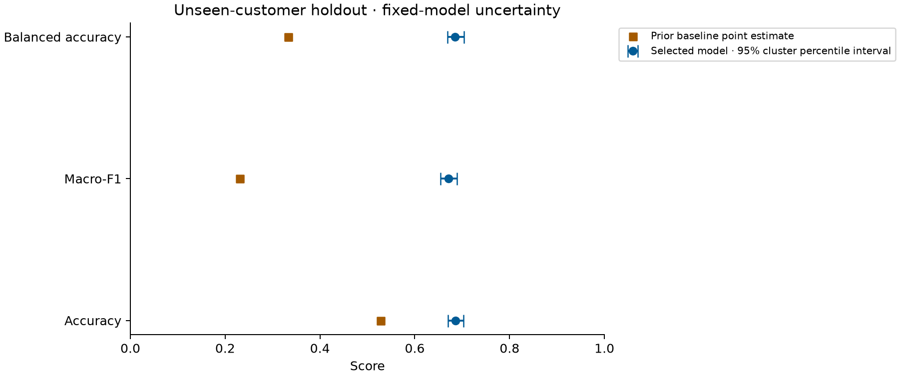
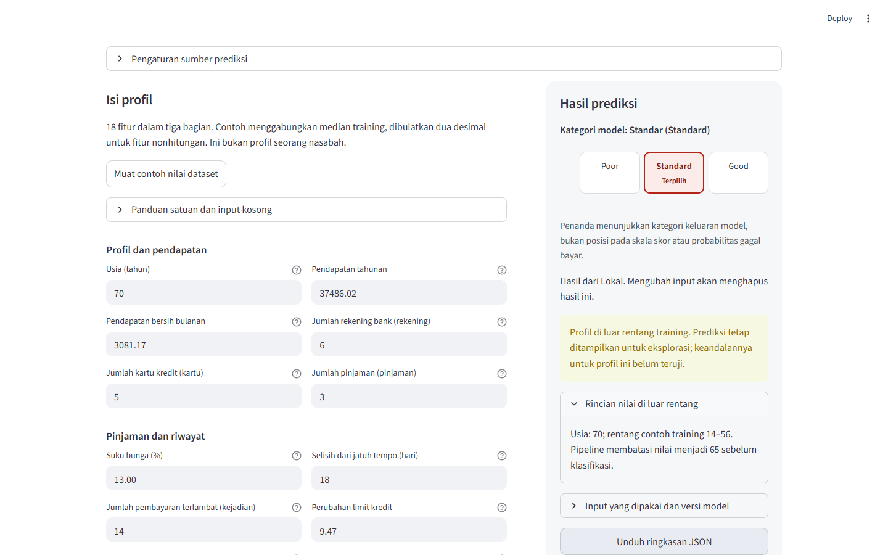

# Credit Score — portfolio case study

[Use the app](https://credit-score-steven.streamlit.app/) · [Browse the source](https://github.com/SevenZ27/UAS)

## Project context and problem

This project continues Steven Gerald Cahyadi's Model Deployment coursework. The portfolio continuation strengthens both the application's prediction flow and the evidence behind its model. It classifies three supplied dataset categories, Good, Standard and Poor. It is an educational prototype: target construction, original currency and real-world lending validity are not established.

The earlier application built an inference row directly from form values. Training and serving transformations were not carried together, numeric restrictions and backend failures could be confusing, and a row-random split mixed customers across training and test. Improving the interface alone would not resolve those modeling weaknesses.

## Implementation and data work

The current app submits 18 explicitly named features through one validated contract. A saved sklearn Pipeline includes parsing, training-fitted median imputation, training-fitted IQR clipping and the classifier. Negative signs on valid signed fields are preserved; malformed source values become missing rather than being converted into invented positive counts. Customer identifiers stay outside the model.

The archived dataset contains 25,000 customer-month observations from 11,254 customers. A reserved customer-disjoint holdout contains 5,011 observations from 2,251 customers; development contains 19,989 observations from 9,003 customers. Five grouped development folds fit all data-dependent transforms separately. Six primary classifiers and two development-only preprocessing sensitivity variants were run. Mean fold macro-F1 selected the model before holdout scoring; the chosen model is a 300-tree Random Forest with minimum leaf size three and balanced subsample weights.

## Results and interpretation

| Held-out customer observations | Selected model | Prior baseline |
| --- | ---: | ---: |
| Accuracy | 68.61% | 52.78% |
| Macro-F1 | 0.6709 | 0.2303 |
| Balanced accuracy | 68.50% | 33.33% |

Customer-cluster bootstrap resampling preserves repeated observations within each sampled customer. Across 2,000 replicates, the 95% accuracy interval is 67.05–70.28%; the paired accuracy improvement over baseline is 15.83 percentage points, interval 13.45–18.23. These intervals condition on the fixed fitted model and source dataset.

The report also includes confusion counts, class precision/recall, missingness and age slices, calibration diagnostics and preprocessing sensitivities. Good precision is 54.84%; Poor recall in the exploratory age-45+ slice is 30.16% among 126 actual Poor observations. These weaknesses are shown, not hidden behind aggregate accuracy. Calibration diagnostics are not served as personal confidence. See the [model card](MODEL-CARD.md) and [frozen evaluation](STAGE-TWO.md).

## Application and UX

The application remains Streamlit with grouped fields, an adjacent category panel on desktop and a stacked layout on narrow screens. Explicit numeric parsing accepts a decimal dot or comma while rejecting ambiguous mixed separators. Editing, reset and backend changes clear stale predictions. Nullable fields show imputation warnings. Results/errors receive keyboard focus once; editing retains focus. Downloadable JSON records the submitted profile, model version, category and warnings.

Valid inputs outside the training reference range still receive predictions, with a visible reliability warning and expandable details about the original pipeline's clipping. Basic invalid values remain errors. Monetary labels are plain, while help text preserves the unknown-currency limitation. The current [serving policy](SERVING-POLICY.md) is separate from the historical strict-domain coverage analysis.

Semantic landmarks, labeled fields, 44 px input/action targets, visible focus, accessible benchmark tables and reduced-motion behavior support keyboard and mobile use. Automated checks cover 1440, 900, 390 and 320 px, touch emulation, result/error/recovery flows and downloads. Axe found zero violations in checked states; physical-device and formal accessibility certification are outside this evidence.

## Delivery and reproducibility

The public application uses the included model bundle for local CPU inference on Streamlit Community Cloud, with Python 3.12 and pinned dependencies. Optional SageMaker hooks package the same pipeline and exploration policy; package parity is verified without claiming a running AWS deployment. The 119-test suite covers contracts, preprocessing, evaluation, service behavior and UI integration. The [release record](RELEASE.md) links final evidence.

The public repository includes source, aggregate data/model documentation, frozen reports, figures, screenshots, tests and the active fitted model. Raw CSV, identifiers, split indices and per-observation outputs remain private. Reproduction of training and independent row-level metric checks requires an authorized copy of those private source files. Running the app does not.

## Boundaries for CV and interview claims

Describe this as a coursework project continued through reproducible evaluation and deployment. Supported claims are customer-grouped model comparison, a shared fitted pipeline, documented uncertainty/error analysis, accessible Streamlit UI and verified serving parity. Do not describe it as an externally validated lending score, an individual confidence estimator, a proven fairness assessment or an active AWS endpoint. Wider accepted inputs do not establish wider predictive validity. Further tuning requires a new untouched evaluation set for new confirmatory claims.
