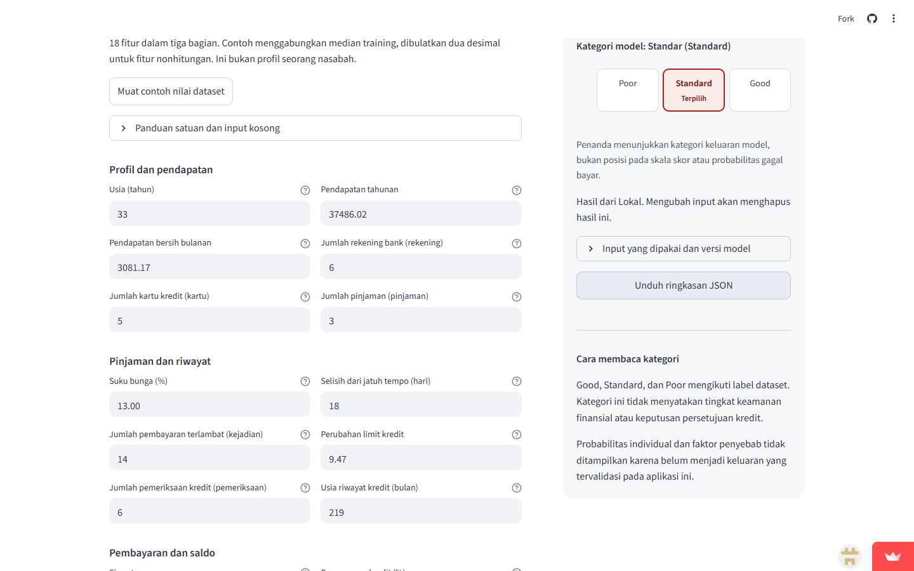

# Credit Score release — 21 October 2026

**Live:** https://credit-score-steven.streamlit.app/

**Source:** https://github.com/SevenZ27/UAS

**Application commit:** `cc04447726dcac77383750df87b9c9f896e8f56d` ([view source](https://github.com/SevenZ27/UAS/tree/cc04447726dcac77383750df87b9c9f896e8f56d)).

Streamlit Community Cloud runs repository `SevenZ27/UAS`, branch `main`, entrypoint `app_streamlit.py`, Python 3.12. The build installed the pinned environment from `uv.lock`. The app uses its included fitted model for local CPU inference without secrets, private CSV or an AWS endpoint. The final evidence/documentation commit does not change application behavior.

## Verified application and model

Model version: `stage2-49c6876730d2`. Model SHA-256: `d8f6ce0302a8954f4f15be17ad726bd26068ffacb3b2396bc0867f73a0af20b1`. Frozen holdout report SHA-256: `3c38004eadfb556d0f27c6dc49f74bbb51a96fed2b42b91b5e2fca36e41a7cc9`.

The initial finalization commit `75363f1` published the pipeline, evaluation, UI, active model and documentation. Commit `cc04447` added an accessible name to the Community Cloud source icon after verifying that it opens the actual GitHub source file. The live checks waited for that new label, confirming the updated UI was active.

- **119 tests passed**, with Ruff passing. [JUnit evidence](verification/tests-release.xml).
- Independent verification confirmed frozen metrics, customer splits, preprocessing statistics and source/protocol hashes. The fitted model and report are unchanged. [Evaluation evidence](verification/evaluation-stage-two.json).
- Fresh-process packaged inference matched the local model and warnings on three profiles, including missing and unfamiliar-range values; no AWS resource was invoked. [Package evidence](verification/sagemaker-package.json).
- A clean checkout of the published source loaded the model, predicted an unfamiliar profile and rendered the app without private data. Frozen source and figure checksums matched. All 20 original course archive files were unchanged.
- Local and **public** browser checks passed at widths 1440, 900, 390 and 320 px, including touch emulation, normal and unfamiliar-range results, errors/recovery, missing values, reset and download. Downloaded public responses matched the actual local model response exactly, retaining the original unfamiliar input and warnings. [Public evidence](verification/browser-live.json), [local evidence](verification/browser-release-local.json).
- Axe found zero violations in the checked application-frame states. Its one inconclusive 320 px contrast check concerned a partially obscured Age input; direct measurement after scrolling found **11.18:1**, exceeding 4.5:1. [Manual contrast evidence](verification/cloud-contrast.json). Keyboard, focus, 200% text, reduced motion and narrow table checks passed locally. [Keyboard evidence](verification/keyboard-release-local.json). This is not formal accessibility certification or physical Safari testing.

[Machine-readable release evidence](verification/release.json) records the full application commit and model hash. Public verification targets the embedded application frame supplied by Community Cloud; it does not count unrelated hosting/status-page UI as application content.

## Portfolio and CV delivery

The repository now includes the [portfolio case study](PORTFOLIO.md), [data card](DATA-CARD.md), [model card](MODEL-CARD.md), [contract](DATA-CONTRACT.md), [current serving policy](SERVING-POLICY.md), frozen evaluation, figures, screenshots, tests and active model. Raw CSV, identifiers, split indices and per-observation predictions are not published. Historical milestone reports retain their recorded state and link to the current policy.

Both local ATS CVs were updated in DOCX and PDF, with clickable live/source links. Each rendered PDF has two pages; all four pages were visually reviewed and link styling was rechecked on changed pages. Unrelated paragraphs and the previous CV versions are preserved. The App Developer entry emphasizes validated serving, range warnings, accessibility and testing; the Data Analyst entry emphasizes grouped model comparison, holdout macro-F1, baseline, uncertainty and error/calibration analysis. CV files and their private support records remain outside the public repository.

The public release permits schema-valid values outside training reference ranges with warnings and discloses actual fitted-pipeline clipping. It does not retrain the model or validate unfamiliar profiles. Original currency, data distribution rights, target construction and external/temporal lending validity remain unresolved. This is a portfolio demonstration of dataset-category classification, not a loan decision service.
