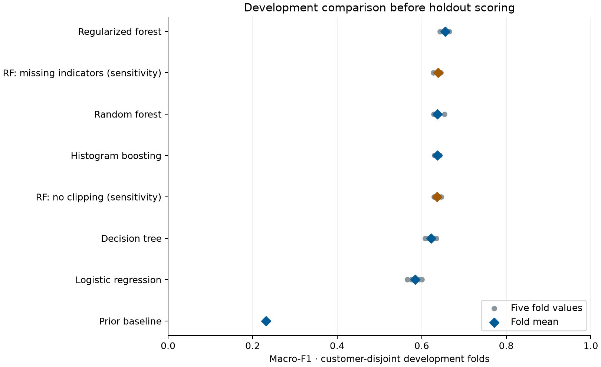
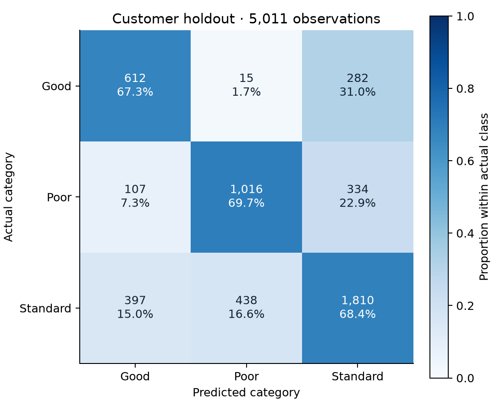
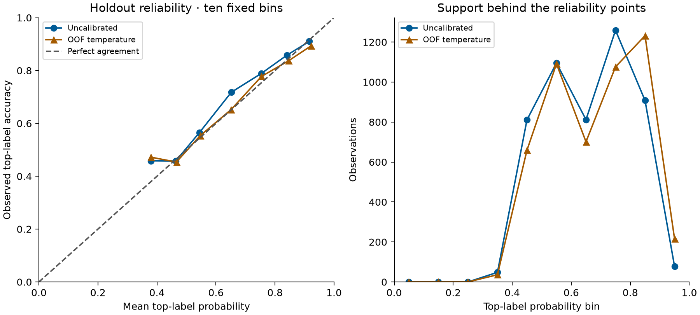

# Credit Score: evaluasi tahap kedua

Historical milestone: this report describes its recorded state. The current public input-range behavior is documented in [SERVING-POLICY.md](SERVING-POLICY.md); final delivery is recorded in [RELEASE.md](RELEASE.md).

Evaluasi 21 Oktober 2026 memilih Random Forest 300 pohon melalui validasi berdasarkan nasabah. Pada holdout 5.011 observasi dari 2.251 nasabah yang terpisah, accuracy mencapai **68,61%** dan macro-F1 **0,671**. Baseline yang selalu memprediksi kelas mayoritas menghasilkan accuracy **52,78%** dan macro-F1 **0,230**. Model ini mengklasifikasikan label dataset; hasilnya belum mengukur gagal bayar atau kelayakan pinjaman.

Versi bundle: `stage2-49c6876730d2`. Sumber angka lengkap tersedia dalam [laporan JSON](evaluation/stage-two/holdout-results.json), [hasil setiap fold](evaluation/stage-two/cv-folds.csv), dan [model card](MODEL-CARD.md).

## Pemisahan nasabah dan pemilihan model

CSV asli tetap berisi 25.000 observasi customer-month dari 11.254 nasabah. Split tahap pertama dipertahankan persis: 19.989 observasi dari 9.003 nasabah untuk development, serta 5.011 observasi dari 2.251 nasabah untuk holdout. Tidak ada nasabah yang muncul di kedua bagian. Customer_ID dipakai hanya untuk mengelompokkan split dan bootstrap, bukan sebagai fitur.

Development memakai lima fold StratifiedGroupKFold dengan seed 42. Dalam setiap fold, nasabah training dan validation terpisah, ketiga kelas tersedia, dan setiap observasi memperoleh tepat satu prediksi out-of-fold. Parsing, median imputation, batas IQR, serta scaling untuk regresi logistik berada di dalam pipeline masing-masing fold. Statistik dari validation dan holdout tidak dipakai untuk fitting transformasi.

[Protokol](EVALUATION-PROTOCOL.md) dikunci sebelum evaluasi. Enam kandidat utama dibandingkan dengan mean fold macro-F1 sebagai metrik pemilihan. Dua variasi preprocessing diperiksa sebagai sensitivitas development dan tidak ikut pemilihan. Parameter serta model terpilih disimpan dalam [selection.json](evaluation/stage-two/selection.json) sebelum penilaian holdout. Hanya model terpilih dan baseline yang dinilai pada holdout; kandidat lain tidak dicoba di holdout untuk memilih ulang.

| Kandidat development | Mean macro-F1 | SD antar-fold | Mean accuracy | Mean log loss |
| --- | ---: | ---: | ---: | ---: |
| Prior / kelas mayoritas | 0,2315 | 0,0000 | 53,21% | 1,0015 |
| Logistic regression | 0,5844 | 0,0136 | 63,28% | 0,7857 |
| Decision tree | 0,6218 | 0,0107 | 65,51% | 1,5302 |
| Random Forest 100 pohon | 0,6371 | 0,0105 | 67,42% | 0,7418 |
| Random Forest 300, leaf minimum 3, balanced_subsample | **0,6553** | 0,0082 | 67,45% | 0,7196 |
| Histogram gradient boosting | 0,6371 | 0,0063 | 67,31% | 0,7217 |
| Sensitivitas RF100 tanpa clipping | 0,6359 | 0,0066 | 67,44% | 0,7380 |
| Sensitivitas RF100 dengan missing indicators | 0,6388 | 0,0072 | 67,65% | 0,7477 |

SD menjelaskan variasi lima fold, bukan confidence interval. Selisih sensitivitas terhadap RF100 kecil; hasil ini belum membuktikan suatu kebijakan preprocessing lebih baik secara umum. Random Forest terpilih memiliki mean macro-F1 tertinggi di antara kandidat yang ditetapkan, bukan jaminan algoritma terbaik untuk semua populasi.

Titik abu-abu adalah nilai setiap fold; berlian adalah mean. Berlian jingga menandai sensitivitas yang tidak ikut pemilihan. Sebaran titik bukan interval kepercayaan.

## Hasil holdout dan ketidakpastian

| Metrik | Model terpilih | Baseline prior | Interval 95% model |
| --- | ---: | ---: | ---: |
| Accuracy | 68,61% | 52,78% | 67,05–70,28% |
| Macro-F1 | 0,6709 | 0,2303 | 0,6542–0,6886 |
| Balanced accuracy | 68,50% | 33,33% | 66,87–70,37% |
| Weighted-F1 | 0,6884 | 0,3647 | Tidak dihitung |
| Log loss, lebih rendah lebih baik | 0,7024 | 1,0062 | Tidak dihitung |
| Brier multikelas, lebih rendah lebih baik | 0,4211 | 0,6040 | Tidak dihitung |

Brier dihitung sebagai rata-rata **jumlah** kuadrat error probabilitas pada ketiga kelas, tanpa pembagian tambahan dengan jumlah kelas. Interval memakai 2.000 bootstrap berkelompok pada nasabah, seed 20261021; semua observasi bulanan nasabah yang tersampel tetap bersama. Selisih accuracy terhadap baseline adalah **15,83 poin persentase**, dengan interval berpasangan 95% **13,45–18,23 poin persentase**. Selisih macro-F1 adalah 0,4406, interval 0,4215–0,4599.

Interval tersebut bersyarat pada model yang sudah dilatih dan sampel dataset ini. Interval belum mencakup ketidakpastian dari pelatihan ulang, pemilihan kandidat, atau perubahan populasi. Setiap observasi bulanan memiliki bobot sama pada metrik utama. Saat total bobot setiap nasabah disamakan menjadi satu, accuracy adalah 68,58% dan macro-F1 0,6693; perbedaan pembobotan ini tidak banyak mengubah hasil pada sampel tersebut.

## Error per kelas

| Kelas aktual | Observasi | Precision | Recall | F1 |
| --- | ---: | ---: | ---: | ---: |
| Good | 909 | 54,84% | 67,33% | 0,6044 |
| Poor | 1.457 | 69,16% | 69,73% | 0,6945 |
| Standard | 2.645 | 74,61% | 68,43% | 0,7139 |

Precision Good sebesar 54,84% berarti hampir separuh prediksi Good tidak cocok dengan label aktual dataset. Contoh kesalahan terbesar adalah 438 observasi Standard diprediksi Poor dan 397 observasi Standard diprediksi Good. Ini membatasi interpretasi individual, meskipun skor keseluruhan melampaui baseline.

Slice usia dan missingness merupakan diagnostik eksploratif. Kelompok usia 45+ memiliki 819 observasi dan macro-F1 0,5777. Recall Poor pada kelompok tersebut hanya **30,16% dari 126 observasi berlabel Poor**. Ini menunjukkan kelemahan yang perlu diteliti, belum membuktikan penyebab atau memenuhi audit fairness. Kelompok dengan sedikitnya tiga fitur missing hanya berisi 85 observasi sehingga interpretasinya terbatas. Seluruh slice, dukungan kelas dan metriknya tersedia dalam laporan JSON; tidak ada kebijakan model yang diubah setelah melihat slice holdout.

## Kalibrasi sebagai diagnostik

Satu scalar temperature, T = 0,8913, dipelajari dari probabilitas out-of-fold development model terpilih dengan meminimalkan log loss. Kalibrasi ini dilakukan setelah pemilihan model, sehingga hasil fit development dapat optimistis. Holdout digunakan untuk menilai transformasi yang sudah tetap.

| Diagnostik holdout | Probabilitas asli | Temperature dari OOF |
| --- | ---: | ---: |
| Log loss | 0,7024 | 0,6981 |
| Brier multikelas | 0,4211 | 0,4194 |
| Top-label ECE, 10 bin tetap | 0,0293 | 0,0125 |

Temperature tidak mengubah urutan kelas sehingga accuracy dan F1 tetap sama. ECE bergantung pada bin dan bersifat deskriptif. Penurunan loss dan ECE pada holdout ini belum membuktikan probabilitas terkalibrasi pada populasi baru. API dan aplikasi tetap mengembalikan kategori tanpa persentase keyakinan; temperature disimpan dalam bukti evaluasi, tidak dipakai sebagai skor kelayakan kredit.

## Cakupan kontrak aplikasi

Benchmark utama menjalankan seluruh raw holdout melalui pipeline. Kontrak aplikasi lebih ketat: setelah source parsing, hanya **3.067 dari 5.011 profil (61,2%)** yang diterima. Sebanyak 1.843 observasi memiliki nilai di luar rentang training aplikasi dan 148 memiliki Age wajib yang hilang setelah parsing. Kedua alasan dapat bertumpang tindih.

Pada bagian yang diterima, accuracy adalah 71,80% dan macro-F1 0,6989. Angka tersebut **hanya berlaku untuk subset 61,2%**, bukan seluruh holdout atau jaminan akurasi aplikasi. Rentang aplikasi tidak dilonggarkan berdasarkan hasil holdout. Penelitian cakupan input berikutnya harus dilakukan sebagai eksperimen baru menggunakan development dan evaluasi terpisah.

## Bukti dan reproduksi

- [Split audit](evaluation/stage-two/split-audit.json): jumlah nasabah, baris, kelas, dan hash indeks pada setiap fold.
- [Run protocol](evaluation/stage-two/run-protocol.json): parameter kandidat, runtime, hash sumber data dan kode.
- [Verifikasi independen](verification/evaluation-stage-two.json): pencocokan ulang metrik dengan sklearn, urutan freeze sebelum scoring, hash split/protokol, median train-only, 100 profil diterima yang cocok dengan service dan 10 profil ditolak yang tetap ditolak.
- [Model card](MODEL-CARD.md), [data card](DATA-CARD.md), [kontrak](DATA-CONTRACT.md), serta [manifest grafik](figures/stage-two/manifest.json).
- [Browser desktop/mobile](verification/browser-stage-two.json) dan [paket inference](verification/sagemaker-package.json). Verifikasi ini lokal; tidak menyatakan endpoint AWS telah dideploy atau sehat.

Lihat README untuk perintah. Prediksi per baris, identitas, CSV dan split indices tetap lokal. Source hash serta output final tidak ditimpa oleh evaluasi ulang. Holdout yang sudah dibaca kini menjadi benchmark yang diketahui; pengembangan lanjutan memerlukan holdout baru untuk klaim konfirmatori.

Verifikasi bundle aktif meluluskan 91 tes, termasuk penjagaan split nasabah, validasi kontrak, preprocessing, prediksi dan error handling. Pencocokan metrik independen serta inference dari paket pada proses terpisah juga lulus. Browser diperiksa pada lebar 1.440, 390 dan 320 px: prediksi lokal, penghapusan hasil setelah input diubah, reset contoh, error endpoint kosong dan pemulihan ke mode Lokal berjalan tanpa horizontal overflow atau JavaScript page error.

Audit browser masih mencatat temuan aksesibilitas framework Streamlit: 34 tombol stepper tanpa accessible name dan masalah region/landmark. Pemeriksaan contrast dan urutan heading lulus, tetapi ini **belum kelulusan aksesibilitas penuh**. Perbaikan framework/UI tersebut dicatat untuk tahap UX, terpisah dari validasi model.

## Batas klaim portofolio

Klaim yang didukung: membangun pipeline inference yang sama dengan training, memisahkan nasabah pada holdout dan lima fold, membandingkan enam kandidat termasuk baseline, serta melaporkan error per kelas, bootstrap nasabah, diagnostik probabilitas, sensitivitas dan cakupan input. Tidak didukung: akurasi produksi perbankan, prediksi gagal bayar, persetujuan pinjaman, fairness terjamin, atau peningkatan akurasi terhadap angka historis 73,24%/73,56% yang memakai protokol berbeda.

Asal distributor data, lisensi, mata uang, tahun dan aturan pembentukan label masih belum terverifikasi. Tidak ada validasi temporal atau eksternal. Kejelasan batas ini merupakan bagian hasil evaluasi, bukan sesuatu yang diselesaikan oleh skor internal.

## Referensi metode dan bantuan prosedural

Panduan metode: [scikit-learn cross-validation](https://scikit-learn.org/stable/modules/cross_validation.html), [pencegahan data leakage](https://scikit-learn.org/stable/common_pitfalls.html), dan [kalibrasi probabilitas](https://scikit-learn.org/stable/modules/calibration.html). Angka hasil proyek berasal dari artefak lokal yang ditautkan di atas.

Workflow menggunakan skill scikit-learn, statistical-analysis dan scientific-visualization sebagai bantuan prosedural; keputusan dan angka diperiksa melalui kode serta artefak proyek. Atribusi pustaka skill: Kassis, T., Agarwal, V., He, Y., Patel, D., & Brueckner, A. M. (2026). *Scientific Agent Skills: A Library of Procedural Knowledge for Research Agents*. [doi:10.48550/arXiv.2609.00065](https://doi.org/10.48550/arXiv.2609.00065). Referensi ini bukan sumber dataset atau validasi performa Credit Score.
